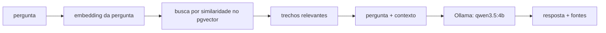
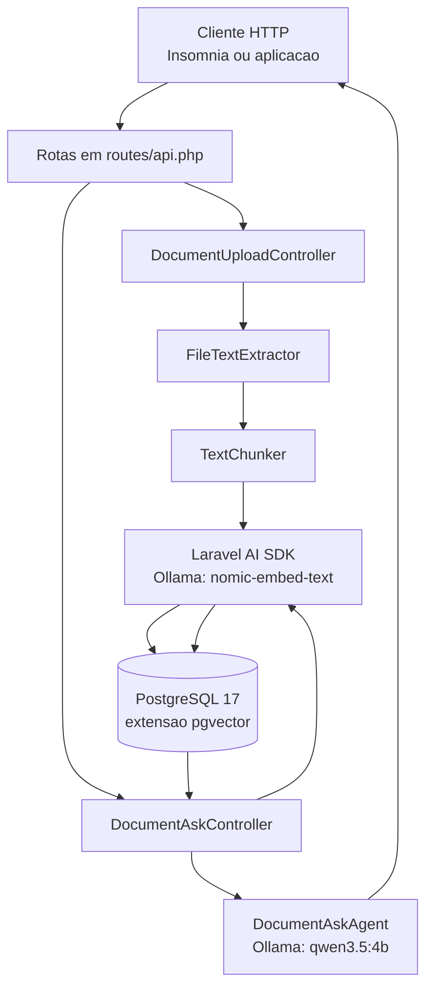
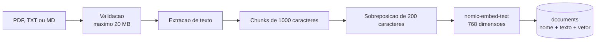
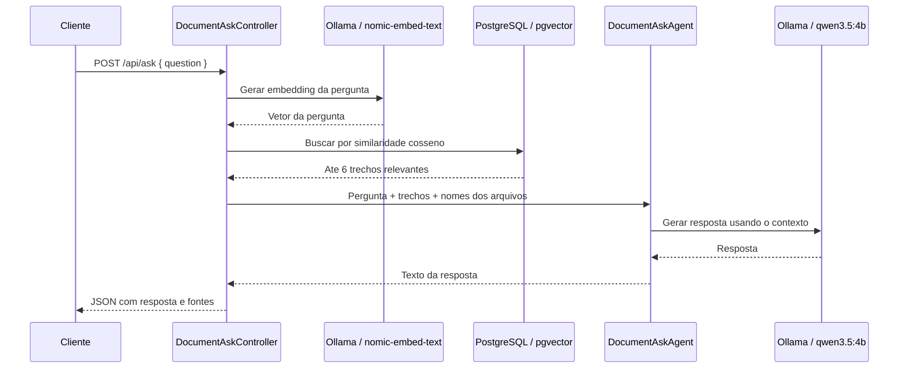

# RAG App

API Laravel para enviar documentos, indexar seus trechos no PostgreSQL com `pgvector` e responder perguntas usando busca sem&acirc;ntica e modelos locais do Ollama.

## O que &eacute; RAG

RAG (*Retrieval-Augmented Generation*, ou gera&ccedil;&atilde;o aumentada por recupera&ccedil;&atilde;o) combina uma busca em uma base de conhecimento com um modelo de linguagem. Em vez de enviar todos os documentos ao modelo, a aplica&ccedil;&atilde;o localiza os trechos mais pr&oacute;ximos da pergunta e os inclui como contexto para gerar a resposta.



## Arquitetura



O Laravel roda em container. O Docker Compose tamb&eacute;m inicia PostgreSQL/pgvector e pgAdmin. O Ollama roda no host e &eacute; acessado pelo container Laravel usando `host.docker.internal:11434`.

## Fluxo de indexacao

O endpoint de upload valida o arquivo, extrai o texto, divide o conte&uacute;do em trechos, gera um embedding para cada trecho e grava texto e vetor no PostgreSQL. O upload s&oacute; &eacute; confirmado depois que os embeddings s&atilde;o gerados e todos os trechos s&atilde;o gravados em uma transa&ccedil;&atilde;o.



A sobreposi&ccedil;&atilde;o mant&eacute;m parte do contexto entre trechos vizinhos:

```text
Trecho 1: caracteres   0-999
Trecho 2: caracteres 800-1799  (200 caracteres compartilhados)
Trecho 3: caracteres 1600-2599 (200 caracteres compartilhados)
```

Cada registro de `documents` cont&eacute;m o nome original do arquivo, o &iacute;ndice do trecho, o texto e o vetor de 768 dimens&otilde;es. A migration habilita a extens&atilde;o `vector` e cria &iacute;ndice vetorial para busca por dist&acirc;ncia cosseno.

## Fluxo de perguntas



A busca usa similaridade m&iacute;nima `0.35` e retorna no m&aacute;ximo seis trechos. O agente instrui o modelo a responder em portugu&ecirc;s, usar apenas o contexto recuperado e informar quando os trechos n&atilde;o cont&ecirc;m a resposta. O endpoint permite at&eacute; 300 segundos para a infer&ecirc;ncia local.

## Decisoes de arquitetura

| Decisao | Implementacao | Motivo |
| --- | --- | --- |
| Banco vetorial | PostgreSQL 17 com pgvector | Mantem dados relacionais e embeddings no mesmo banco e permite busca por similaridade. |
| Embeddings | `nomic-embed-text`, 768 dimensoes | Modelo local dedicado a representacao vetorial; a dimensao coincide com a coluna `vector(768)`. |
| Geracao de resposta | `qwen3.5:4b` via Ollama | Modelo local menor, configuravel pela variavel `OLLAMA_TEXT_MODEL`. |
| Chunking | 1000 caracteres com 200 de sobreposicao | Limita o contexto enviado ao modelo e preserva contexto nas bordas entre trechos. |
| Extracao | PDF via Smalot PDF Parser; TXT/MD via leitura local | Processa formatos de texto comuns sem enviar arquivos a um servico externo. |
| Persistencia do upload | Nome, trechos e embeddings | O binario enviado nao e armazenado; o conteudo indexado fica na tabela `documents`. |
| Execucao | Sincrona | Mantem a API simples para desenvolvimento local; o cliente aguarda extracao, embeddings e resposta. |
| Memoria de conversa | Nao persistida | Cada pergunta e independente; o endpoint nao reutiliza conversas anteriores. |
| Docker | Laravel em container de desenvolvimento | O codigo e montado como volume, enquanto as dependencias Composer ficam em volume nomeado. |

## API

As rotas estao em `routes/api.php` e recebem o prefixo `/api` do bootstrap do Laravel.

### Enviar um documento

`POST /api/documents`

Use `multipart/form-data` com o campo `file` do tipo arquivo. Sao aceitos PDF, TXT e Markdown, com tamanho maximo de 20 MB.

Exemplo com cURL:

```bash
curl -X POST http://localhost:8000/api/documents \
  -F "file=@./documento.pdf"
```

Resposta de sucesso (`201`):

```json
{
  "message": "Documento processado e indexado com sucesso.",
  "source_file": "documento.pdf",
  "chunks_created": 12
}
```

### Perguntar sobre os documentos

`POST /api/ask`

Envie JSON com a pergunta:

```json
{
  "question": "Quais sao os principais pontos do documento?"
}
```

Resposta:

```json
{
  "answer": "...",
  "sources": ["documento.pdf"]
}
```

Erros de validacao sao retornados como JSON com status `422`. Se a busca nao encontrar trechos acima do limiar de similaridade, a resposta informa que nao encontrou conteudo relevante.

## Requisitos

- PHP 8.3 ou superior e Composer (para desenvolvimento fora do Docker).
- Docker Desktop com suporte ao Docker Compose.
- Ollama instalado e em execucao no host.
- Modelos `qwen3.5:4b` e `nomic-embed-text` baixados no Ollama.

Baixe os modelos no host:

```powershell
ollama pull qwen3.5:4b
ollama pull nomic-embed-text
```

## Como executar com Docker

Na primeira execucao, crie o arquivo `.env` e suba os servicos. Se `php artisan serve` estiver rodando no host, pare-o primeiro porque o container tambem publica a porta 8000:

```powershell
if (!(Test-Path .env)) { Copy-Item .env.example .env }
docker compose up -d --build
```

O container Laravel instala as dependencias Composer no primeiro inicio. Execute as migrations:

```powershell
docker compose exec app php artisan migrate
```

Se `APP_KEY` estiver vazia no `.env`, gere-a uma vez com `docker compose exec app php artisan key:generate`.

A API fica em `http://localhost:8000`. Acompanhe a inicializacao com:

```powershell
docker compose logs -f app
```

Para executar comandos Artisan dentro do container:

```powershell
docker compose exec app php artisan config:clear
```

O Compose configura o Laravel para acessar o banco no host Docker `db:5432` e o Ollama no host em `http://host.docker.internal:11434`. O Compose inclui `extra_hosts` para resolver `host.docker.internal` tambem em Docker Engine no Linux.

Se o Ollama nao aceitar conexoes originadas do container, configure o servidor Ollama do Windows para escutar em `0.0.0.0:11434` pela variavel `OLLAMA_HOST` e reinicie o aplicativo Ollama. O Ollama escuta em loopback por padrao; exponha a porta 11434 apenas a ambientes confiaveis. Consulte a [documentacao de rede do Docker Compose](https://docs.docker.com/compose/how-tos/networking/) e o [FAQ do Ollama](https://github.com/ollama/ollama/blob/main/docs/faq.mdx#how-do-i-configure-ollama-server).

### PostgreSQL e pgAdmin

O Compose publica o PostgreSQL em `localhost:5433` e o pgAdmin em `http://localhost:5050`.

Para cadastrar o PostgreSQL no pgAdmin, use host `db` e porta `5432`, pois os servicos estao na mesma rede Docker. O banco e `rag_app`; as credenciais locais definidas no Compose sao usuario `root` e senha `postgres`.

## Limitacoes atuais

- PDFs escaneados que contenham apenas imagens precisam de OCR, que ainda nao esta implementado.
- O arquivo original nao e armazenado; somente os trechos extraidos e seus embeddings permanecem no banco.
- Reenviar um arquivo adiciona novos trechos; ainda nao ha deduplicacao nem exclusao por documento.
- Os endpoints nao exigem autenticacao. A configuracao atual e voltada ao desenvolvimento local e nao deve ser exposta publicamente sem autenticacao e controles de acesso.
- Extracao, embeddings, busca e geracao sao sincronos; uploads grandes ou inferencia lenta mantem a conexao HTTP aberta.

## Estrutura principal

```text
app/
|-- Ai/Agents/DocumentAskAgent.php
|-- Http/Controllers/Api/
|   |-- DocumentAskController.php
|   `-- DocumentUploadController.php
|-- Models/Document.php
`-- Services/
    |-- FileTextExtractor.php
    `-- TextChunker.php

database/migrations/   # tabelas de conversas e documentos/embeddings
routes/api.php         # endpoints do RAG
config/ai.php          # modelos e endpoint do Ollama
docker-compose.yml     # Laravel, PostgreSQL/pgvector e pgAdmin
Dockerfile             # imagem de desenvolvimento PHP
```
